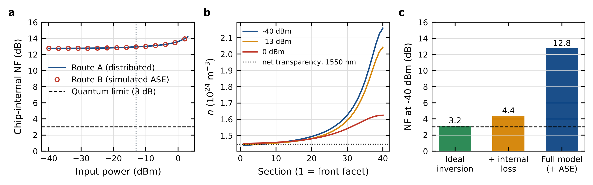
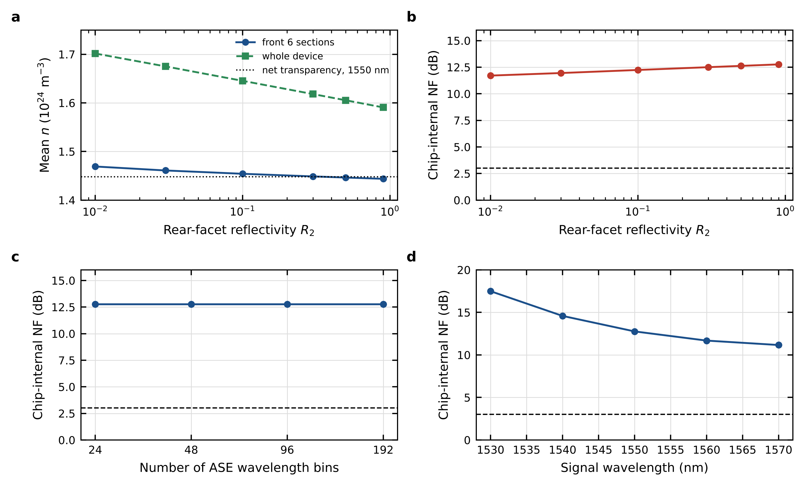

# How far is a reflective SOA from the quantum noise limit?

An extension of my study *Quantitative Device-to-System Analysis of Reflective Semiconductor Optical Amplifiers for Bidirectional WDM-PONs*. The original code and data are archived on Zenodo: [doi.org/10.5281/zenodo.24372240](https://doi.org/10.5281/zenodo.24372240).

**Status:** model-based results, checked for numerical convergence and wavelength dependence. Not yet compared with a measured device.

## The question

Any phase-insensitive amplifier must add noise, a consequence of the uncertainty principle (C. M. Caves, *Phys. Rev. D* 26, 1817, 1982). For an optical amplifier this sets a noise-figure floor of 3 dB at high gain, reached only with complete population inversion (n_sp = 1).

In the original study, amplified spontaneous emission (ASE) was decisive twice: ASE–signal beat noise pushed the 10 Gb/s upstream link over the forward-error-correction threshold, and ASE self-saturation limited the gain of longer devices. This repository asks how far the same RSOA sits from the quantum limit on noise, and what causes the gap.

## Method

The reference RSOA is the one from the paper: bulk InGaAsP, 600 µm, 80 mA, front-facet reflectivity R1 = 1e-5, rear-facet reflectivity R2 = 0.9, signal at 1550 nm. The steady-state model has 40 sections and 48 ASE wavelength bins.

The chip-internal noise figure is computed in two ways (`noise.py`):

1. **Distributed (route A):** the double pass is unfolded into 80 sections, and the ASE born in each section is propagated to the output with the net gain that follows it. Each section is solved exactly, so sections with net loss need no special treatment.
2. **From the simulated ASE (route B):** NF = 2S/G + 1/G, where S is the output ASE spectral density in the signal's polarisation, in units of hν. A narrow 1 GHz probe bin is added to the ASE grid at exactly 1550 nm, so no interpolation is needed. It changes the reference gain by 0.001 dB.

Chip-internal NF is the quantity the quantum limit applies to. Fibre-to-fibre values are 3 dB higher because of the input coupling loss.

## Results



| Input power | Regime | Chip-internal NF |
| --- | --- | --- |
| −40 dBm | Linear | 12.8 dB |
| −16.2 dBm | 3 dB gain compression | 12.9 dB |
| −13 dBm | Operating seed power in the WDM-PON | 12.9 dB |
| 0 dBm | Deep saturation | 13.6 dB |

The two routes agree to within 2 × 10⁻⁵ dB across the sweep. They share the same gain model and discretisation, so this agreement confirms the propagation and bookkeeping, not the gain model itself.

**Decomposition of the gap at −40 dBm.** With no light in the device, the bias alone sets the carrier density to 2.59 × 10²⁴ m⁻³ and n_sp = 1.04.

| Model | Chip-internal NF |
| --- | --- |
| Ideal inversion from the bias alone, no internal loss | 3.2 dB |
| Adding internal loss | 4.4 dB |
| Full model, including ASE self-saturation | 12.8 dB |

The ideal case reproduces the quantum limit, a consistency check on the method. Internal loss adds about 1 dB. ASE self-saturation adds the remaining 8 dB: it holds the front sections within 0.5% of net transparency, the density at which modal gain just balances internal loss (1.45 × 10²⁴ m⁻³ at 1550 nm). At −40 dBm, six of the 40 sections nearest the input facet have net loss at 1550 nm. Noise generated there is amplified by the rest of the device, so this region dominates the noise figure. Signal saturation adds less than 1 dB on top.

## Validation



| Check | Result | Conclusion |
| --- | --- | --- |
| ASE grid, 24 to 192 bins | NF changes by 0.001 dB | Numerically converged |
| Signal wavelength, 1530 to 1570 nm | NF from 17.5 dB (1530 nm) to 11.2 dB (1570 nm) | The gap is at least 8 dB at every wavelength, but its size depends strongly on wavelength |
| Rear-facet reflectivity, R2 = 0.9 to 0.01 | NF falls from 12.8 to 11.7 dB; front-section density rises only from 1.444 to 1.469 × 10²⁴ m⁻³, while the whole-device mean rises from 1.59 to 1.70 × 10²⁴ m⁻³ | ASE returning from the rear mirror is a minor contributor at the input facet |
| Comparison with a measured RSOA | Not yet done | Open |

The rear-facet result revised my initial hypothesis. I expected ASE reflected from the rear mirror to clamp the input region. Instead, the front sections stay near net transparency even with an almost non-reflecting rear facet. They are clamped mainly by ASE generated along the device and amplified on its way toward the input facet. The mirror strongly affects the inversion deeper in the device, but not where the noise figure is set.

**Caveats.** The absolute values depend on model choices: the high internal loss of the bulk material set (K0 = 6200 m⁻¹, after Connelly 2001), phase-averaged ASE, and bulk rather than quantum-well gain. A quantum-well device would likely sit closer to the limit. Comparison with measured data is the next step.

## Repository layout

```
material.py            bulk InGaAsP gain, recombination and loss (unchanged from the Zenodo record)
rsoa_steady.py         segmented steady-state RSOA model with wideband ASE (unchanged)
style.py               figure style (unchanged)
noise.py               noise-figure routes A and B, probe bin, net-transparency density
run_noise_figure.py    NF versus input power and the decomposition -> results/noise_figure.json
run_validation.py      grid, wavelength and rear-facet checks -> results/validation.json
results/               numerical outputs (JSON)
figures/               figures (PNG and PDF)
```

## Reproduce

```
pip install -r requirements.txt
python run_noise_figure.py     # about 5 s
python run_validation.py       # about 5 s
```

Tested with Python 3.12, NumPy 2.5, SciPy 1.18 and Matplotlib 3.11.

## Citation

Please cite the original study and this repository (see `CITATION.cff`).

## Licence

MIT (see `LICENSE`).
